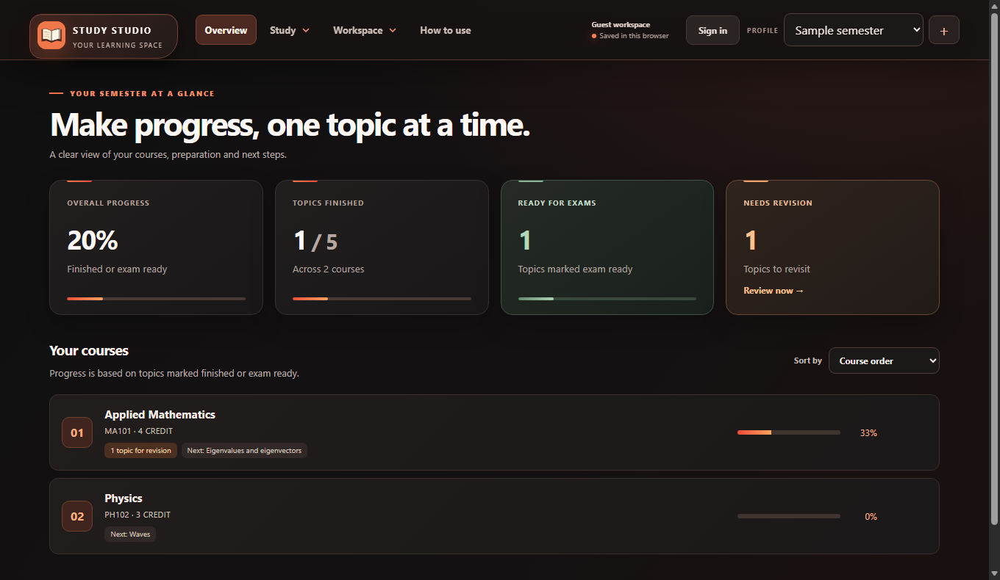

<p align="center"></p>
<h1 align="center">Study Studio</h1>
<p align="center">A study workspace for tracking your syllabus, planning revision and projecting grades.</p>
<p align="center">
  <a href="https://studystudio-tracker.vercel.app/"><strong>Open Study Studio</strong></a>
  · <a href="#quick-start">Quick start</a>
  · <a href="https://studystudio-tracker.vercel.app/privacy.html">Privacy &amp; data</a>
</p>



## What you can do

| Feature | How it helps |
| --- | --- |
| **Semester profiles** | Keep each semester’s courses, units, topics, progress and scores together. Start with a blank workspace for any program. |
| **Curriculum import** | Extract a draft from a PDF, DOCX or TXT file, review it, and create one profile per detected semester. |
| **Progress and revision** | Track a status for each topic, see how your subjects compare and jump into topics marked for revision. |
| **Grade planning** | Enter weighted assessments to project subject grade points, SGPA and CGPA. Calculate the average needed on remaining assessments to reach a target. |
| **Private sync and backups** | Sign in with Google, GitHub or email to resume on another device. Export a JSON backup at any time. |

## Quick start

1. **Open the app.** Sign in to sync your workspace, or start as a guest in your browser. Confirm your email if you create an email and password account.
2. **Add your syllabus.** Use **Workspace → Import curriculum** and review the proposed courses, credits, units and topics before saving. To enter them yourself, use **Workspace → Manage workspace → Add course**, then add units and topics in **Course editor**.
3. **Track your progress.** Open **Study → Syllabus tracker** to update individual topics. **Finished** and **Exam ready** count toward completion. Open **Subject overview** to compare courses and check progress by unit.
4. **Plan your marks.** In **Study → Scores & grades**, enter each assessment’s score, maximum and weight. Set your grade boundaries, then use the **Target grade calculator** or enter previous credits and CGPA for a cumulative projection.

Open **How to use** in the top navigation for the complete guide, including defaults, syncing and moving guest work.

## Import and grade estimates

The importer processes files up to 20 MB in your browser. Run OCR on image-only PDFs first. Results depend on the document layout, so check any generated course codes and credits, and fill in missing units before creating profiles.

Grade projections extend your current weighted average across remaining course weight. SGPA uses credit-weighted predictions for eligible scored courses. CGPA adds the previous credits and CGPA you enter. The target calculator shows the average needed across all unentered weight. If the final exam is the only unentered assessment, that average is the percentage needed on that exam. Follow your institution’s published grading and exam rules for official results.

## Run locally

The app uses static HTML, CSS and JavaScript. Serve the repository root with a local HTTP server. For example, with Python 3 installed:

```sh
git clone https://github.com/NotAsh0/study-studio.git
cd study-studio
python -m http.server 4173 --bind 127.0.0.1
```

Open [http://127.0.0.1:4173/](http://127.0.0.1:4173/). Guest mode works locally. For your own deployment with account sync, configure a Supabase project and allow the local URL in its authentication settings.

- [Supabase setup and storage](backend/README.md)
- [Vercel deployment and sign-in setup](backend/VERCEL-AND-LOGIN.md)
- Run the curriculum importer checks with `node tests/curriculum-import.cjs`.

For bugs or feature requests, use [GitHub Issues](https://github.com/NotAsh0/study-studio/issues). If an import fails, describe the document format and share a redacted example of the layout.
